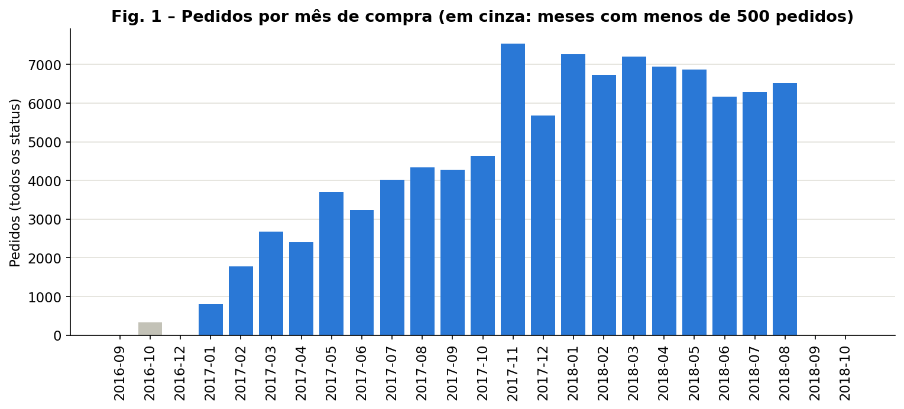
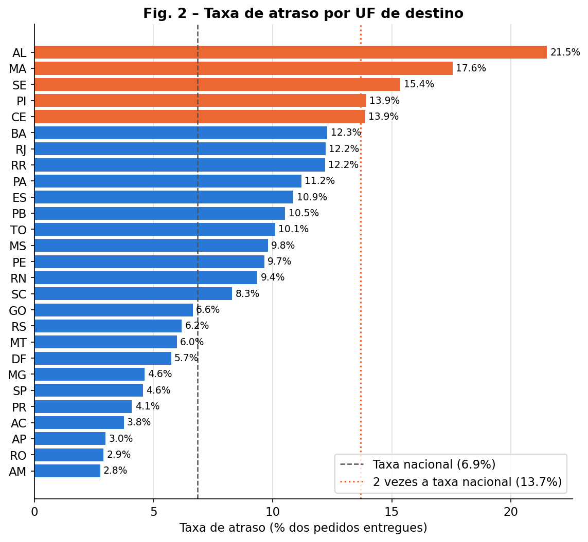
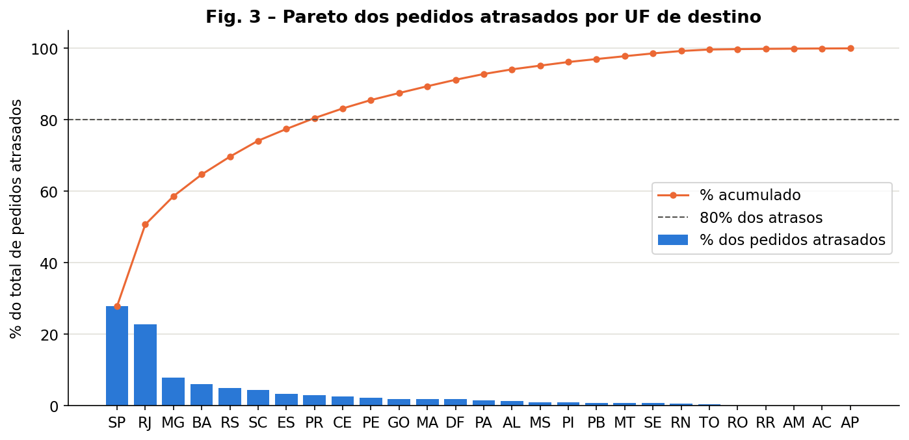
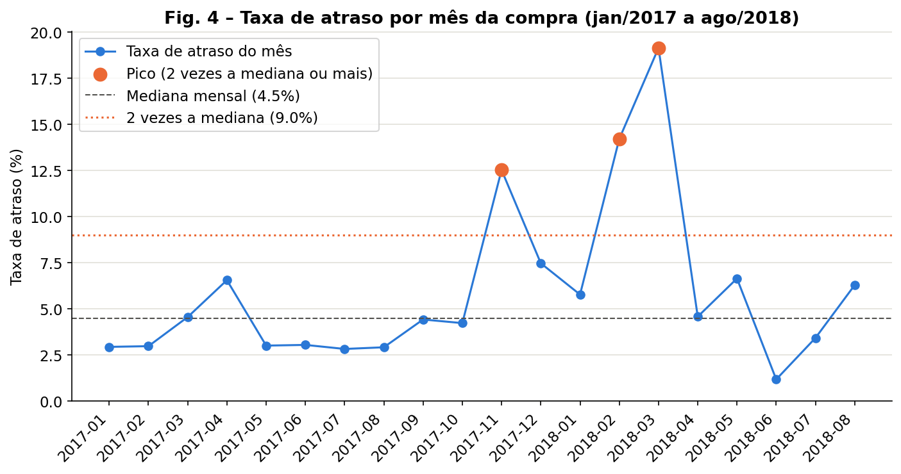
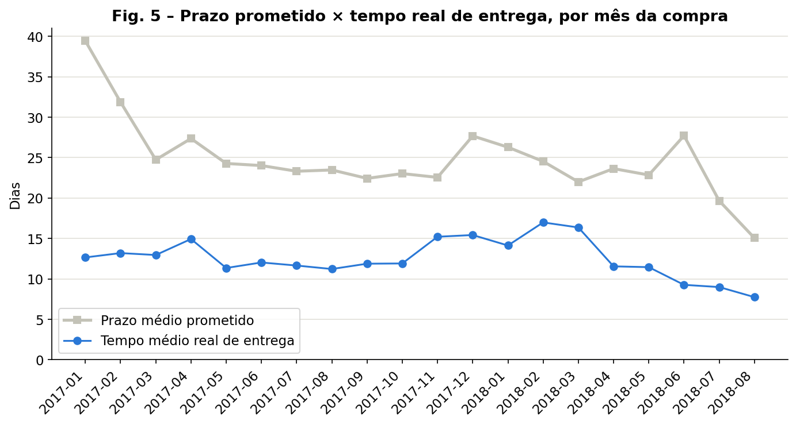
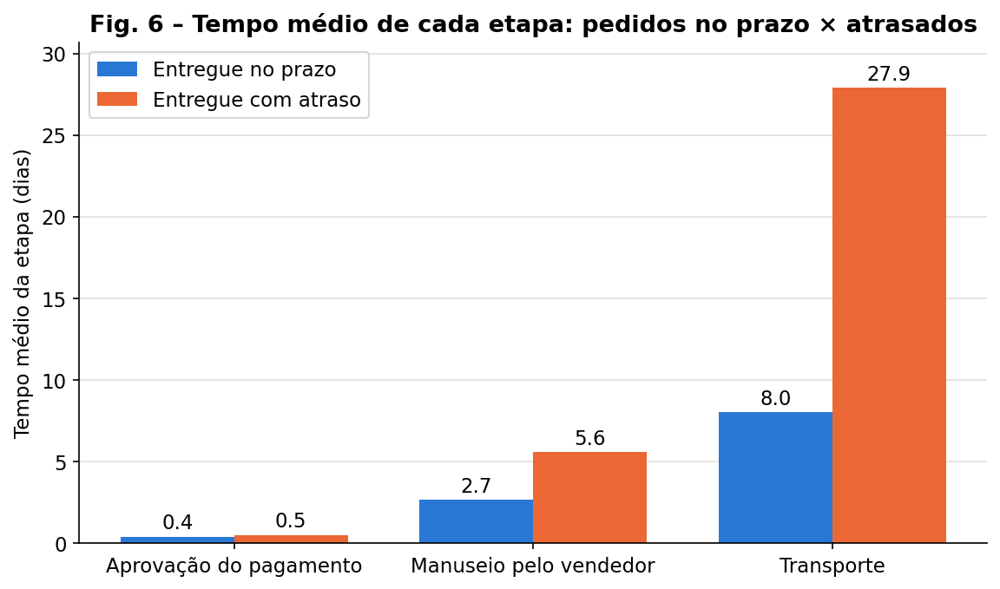
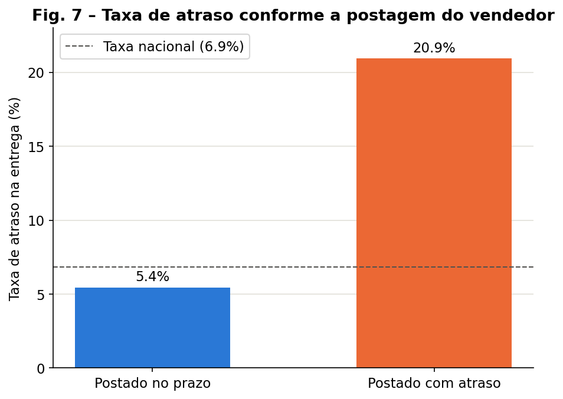
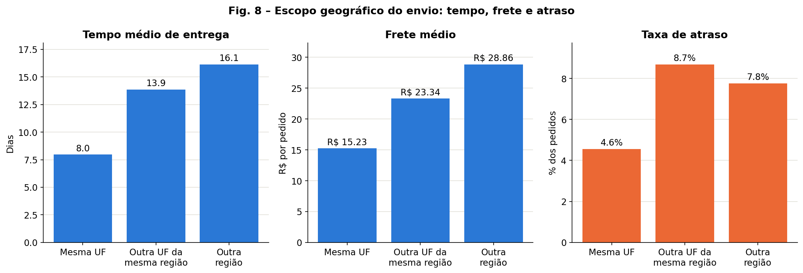
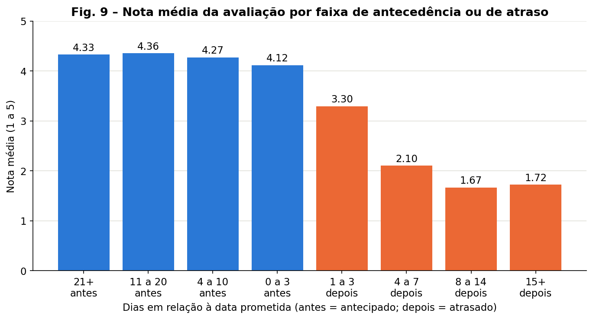
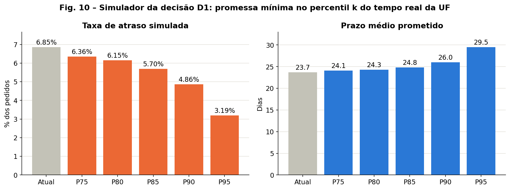

# MVP — Sistema de Suporte à Decisão para Atrasos de Entrega no E-commerce (Olist)

**Universidade de Brasília (UnB) · Departamento de Engenharia de Produção**
**Disciplina:** Sistemas de Suporte à Decisão · **Professor:** André Luiz Marques Serrano
**Aluno(a):** *[seu nome]* · **Matrícula:** *[sua matrícula]*

Pipeline de dados em nuvem (Google Colab + Google Drive) que transforma os pedidos públicos da Olist em um esquema estrela, diagnostica **onde, quando e por que** as entregas atrasam e propõe uma **linha de tomada de decisão**: regras que indicam o que fazer em cada UF e um simulador que mostra o efeito de cada opção.

> **Resultado em uma frase:** os atrasos não são aleatórios. A taxa nacional é de 6,85%, mas chega a 21,5% em Alagoas; SP e RJ concentram metade dos atrasos; o transporte responde por 74% do tempo de entrega; e o atraso derruba a nota do cliente de 4,31 para 2,27. Se a promessa mínima de cada UF fosse o percentil 90 do tempo real de entrega, a taxa de atraso cairia para 4,86%, com 2,3 dias a mais no prazo médio prometido.

| Entregável | Onde está |
|---|---|
| Notebook completo (coleta → ETL → modelagem → análise → decisão) | [`notebooks/MVP_Olist_Entregas.ipynb`](notebooks/MVP_Olist_Entregas.ipynb) |
| Catálogo de dados, diagrama do modelo e perfil de qualidade | [`catalogo/`](catalogo/) |
| Gráficos, painel de decisão e simulação de cenários | [`evidencias/`](evidencias/) |

## Sumário

1. [Objetivo](#1-objetivo)
2. [Plataforma e arquitetura](#2-plataforma-e-arquitetura)
3. [Busca, licença, ética e LGPD](#3-busca-licença-ética-e-lgpd)
4. [Coleta](#4-coleta)
5. [Transformação e carga (ETL)](#5-transformação-e-carga-etl)
6. [Modelagem e catálogo de dados](#6-modelagem-e-catálogo-de-dados)
7. [Análise](#7-análise)
8. [Autoavaliação](#8-autoavaliação)
9. [Como reproduzir](#9-como-reproduzir)
10. [Estrutura do repositório e evidências](#10-estrutura-do-repositório-e-evidências)
11. [Referências](#11-referências)

---

## 1. Objetivo

**Problema.** Em um *marketplace*, não se sabe onde, quando e em qual etapa do processo os atrasos de entrega se concentram, nem quanto eles custam em satisfação do cliente. Sem esse diagnóstico, as ações tendem a ser genéricas (por exemplo, aumentar o prazo de todos os pedidos) e caras.

**Objetivo do MVP.** Construir um pipeline de dados em nuvem (busca → coleta → transformação e carga → modelagem → análise) que produza esse diagnóstico e o transforme em uma linha de tomada de decisão, como pede um sistema de suporte à decisão (SSD).

**Hipótese (H).** Os atrasos não são aleatórios: concentram-se em algumas UFs de destino e em meses de pico, crescem quando o pedido sai do estado do vendedor, nascem principalmente na etapa de transporte e reduzem a satisfação do cliente. Métrica principal: **taxa de atraso** (% de pedidos entregues depois da data prometida). Métrica de impacto: **nota média** da avaliação (1 a 5).

**Critérios definidos antes da análise.** A hipótese é confirmada com os cinco critérios atendidos, parcialmente confirmada com três ou quatro e rejeitada com dois ou menos.

| Critério | Pergunta | Regra |
|---|---|---|
| C1 | P1 | A UF com maior taxa de atraso tem pelo menos 2 vezes a taxa nacional |
| C2 | P2 | Algum mês tem taxa de pelo menos 2 vezes a mediana mensal |
| C3 | P3 | O transporte responde por mais de 50% do tempo médio de entrega **e** a postagem fora do prazo multiplica a taxa de atraso por pelo menos 2 |
| C4 | P4 | A taxa do envio interestadual é de pelo menos 1,5 vez a do envio local |
| C5 | P5 | A nota média dos pedidos atrasados é pelo menos 1 ponto menor |

**Perguntas de negócio.**

| # | Pergunta | Decisão que a resposta apoia |
|---|---|---|
| P1 | Quais UFs de destino têm as maiores taxas de atraso e quais concentram a maior parte dos pedidos atrasados? | Onde priorizar a revisão do prazo prometido e a negociação com transportadoras |
| P2 | Como a taxa de atraso evoluiu mês a mês entre jan/2017 e ago/2018 e em quais meses houve picos? | Planejamento de capacidade para picos (ex.: Black Friday) |
| P3 | Em qual etapa (aprovação, manuseio pelo vendedor ou transporte) está o gargalo, e quanto a postagem fora do prazo aumenta a taxa de atraso? | SLA com vendedores ou com transportadoras |
| P4 | Qual a relação entre o escopo geográfico do envio (mesma UF × interestadual × entre regiões) e o tempo de entrega, o frete e a taxa de atraso? | Prazo e frete por rota; vendedores e estoques perto do cliente |
| P5 | Quanto o atraso reduz a nota de avaliação do cliente? | Justificar o investimento em logística |

**As três dimensões do MVP.**

| Dimensão | Evidência neste MVP |
|---|---|
| Viabilidade técnica | Pipeline executado de ponta a ponta no Colab, com os dados gravados e **relidos** do Google Drive |
| Viabilidade financeira | Custo de operação de R$ 0,00 (versões gratuitas do Colab e do Drive); cerca de 123 MB ocupados (menos de 1% dos 15 GB gratuitos) |
| Desejabilidade | Cinco perguntas ligadas a decisões reais, respondidas com dados e transformadas em regras de decisão (seção 7.3) |

## 2. Plataforma e arquitetura

```
KAGGLE (fonte pública, CSV)
   |  EXTRAÇÃO ........... kagglehub (sem chave de API)
   v
GOOGLE DRIVE  /MVP_Olist_Entregas
   |-- 1_bronze/    5 arquivos originais + registro da coleta
   |       |  TRANSFORMAÇÃO ... pandas (regras R1 a R12)
   |-- 2_prata/     tabelas limpas e padronizadas
   |       |  CARGA ........... esquema estrela em CSV, relido do Drive
   |-- 3_ouro/      fato_entregas + dim_cliente + dim_vendedor + dim_tempo
   |-- catalogo/    catálogo de dados, diagrama e perfil de qualidade
   |-- evidencias/  gráficos, painel de decisão e cenários
   |  ANÁLISE E DECISÃO .. pandas + matplotlib
   v
Respostas P1 a P5  ->  gatilhos G1 a G5  ->  decisões D1 a D4
```

| Ferramenta | Papel |
|---|---|
| Google Colab | Execução em nuvem (Python 3), sem instalação local |
| Google Drive | Persistência das camadas bronze, prata e ouro |
| kagglehub | Extração da base pública |
| pandas / numpy | Limpeza, transformação, esquema estrela, análise e simulação |
| matplotlib | Gráficos salvos em `evidencias/` |

A plataforma Databricks, recomendada pela disciplina, não foi usada; o edital permite outras plataformas desde que os dados fiquem persistidos na nuvem de forma demonstrável, o que é comprovado pela releitura das tabelas do Drive (seção 5).

## 3. Busca, licença, ética e LGPD

| Item | Descrição |
|---|---|
| Base | *Brazilian E-Commerce Public Dataset by Olist* — <https://www.kaggle.com/datasets/olistbr/brazilian-ecommerce> |
| Período | Compras de set/2016 a out/2018 (cerca de 100 mil pedidos) |
| Formato | 9 arquivos CSV relacionais; **5 usados** neste MVP |
| Licença | **CC BY-NC-SA 4.0**: uso não comercial, com atribuição e compartilhamento pela mesma licença |

**Por que esta base:** tem todas as datas do processo (compra, aprovação, postagem, entrega e data prometida), o prazo limite de postagem do vendedor, a UF de clientes e vendedores, o frete e a nota do cliente, exatamente o que as perguntas exigem.

**Tabelas usadas:** pedidos, itens, clientes, vendedores e avaliações. **Não usadas:** geolocalização (a P4 usa o escopo por UF e região), pagamentos, produtos e tradução de categorias.

**Ética e LGPD (Lei nº 13.709/2018).** Os identificadores são códigos *hash*, e a localização se limita ao prefixo do CEP, à cidade e à UF. Pelo princípio da necessidade (art. 6º, III), os comentários em texto livre e o `customer_unique_id` são descartados na camada prata. Os resultados são sempre agregados (UF, mês, etapa, faixa). **Os dados brutos não são versionados neste repositório**: o notebook baixa a base diretamente do Kaggle.

## 4. Coleta

A coleta usa `kagglehub.dataset_download('olistbr/brazilian-ecommerce')`, copia os 5 arquivos para a camada bronze **sem alteração** e grava `registro_coleta.csv` com data e hora (UTC), volume e formato:

| Arquivo | Linhas | Colunas | Tamanho (MB) |
|---|---:|---:|---:|
| olist_orders_dataset.csv | 99.441 | 8 | 16,84 |
| olist_order_items_dataset.csv | 112.650 | 7 | 14,31 |
| olist_customers_dataset.csv | 99.441 | 5 | 8,17 |
| olist_sellers_dataset.csv | 3.095 | 4 | 0,16 |
| olist_order_reviews_dataset.csv | 99.224 | 7 | 13,78 |
| **Total** | **413.851** | | **53,3** |

## 5. Transformação e carga (ETL)

**Regras de negócio** (afetam diretamente a interpretação dos resultados):

| Regra | Tipo | Descrição | Camada |
|---|---|---|---|
| R1 | Padronização de nomes | Colunas em português, minúsculas, sem espaços | prata |
| R2 | Padronização de chaves | CEP como **texto de 5 dígitos** (o CSV gravou como número e perdeu o zero à esquerda) | prata |
| R3 | Enriquecimento | Região do IBGE a partir da UF | prata |
| R4 | Minimização (LGPD) | Descarte dos comentários das avaliações e do `customer_unique_id` | prata |
| R5 | Deduplicação | Uma avaliação por pedido: a de resposta mais recente | prata |
| R6 | Escopo | Só pedidos `delivered` com data de entrega | ouro |
| R7 | Conciliação do grão | Itens resumidos por pedido; pedidos com **mais de um vendedor** excluídos (1.275), porque a data de entrega é única por pedido | ouro |
| R8 | Conversão de unidades | Diferenças de datas em **dias** (segundos ÷ 86.400) | ouro |
| R9 | Inconsistência | Etapa com duração negativa vira nula; o pedido é mantido | ouro |
| R10 | Atraso | Entrega **no dia** posterior à data estimada (a data estimada não tem horário). Comparando data e hora, a taxa seria 8,20% em vez de 6,85% | ouro |
| R11 | Postagem atrasada | Postagem na transportadora depois do `shipping_limit_date` | ouro |
| R12 | Escopo do envio | `tipo_envio` (Local × Interestadual) e `escopo_envio` (Mesma UF × Outra UF da mesma região × Outra região) | ouro |

**Carga e verificação.** As quatro tabelas do esquema estrela são gravadas em CSV na camada ouro e **lidas de volta do Drive**. A verificação confere o número de linhas, duas somas de controle (frete total de R$ 2.143.334,23 e 6.521 pedidos atrasados), a unicidade das chaves primárias e a existência de todas as chaves estrangeiras nas dimensões. Toda a análise usa as tabelas relidas.

| Tabela | Linhas gravadas = lidas do Drive | Carga ok |
|---|---:|---|
| fato_entregas | 95.195 | SIM |
| dim_cliente | 99.441 | SIM |
| dim_vendedor | 3.095 | SIM |
| dim_tempo | 774 | SIM |

## 6. Modelagem e catálogo de dados

**Esquema estrela** com grão **1 pedido entregue de um único vendedor**:

```
                         dim_tempo (PK id_tempo AAAAMMDD)
                                   | 1
                                   | N
dim_cliente (PK id_cliente) 1 -- N fato_entregas N -- 1 dim_vendedor (PK id_vendedor)

fato_entregas: PK id_pedido | FK id_cliente, id_vendedor, id_tempo_compra
  medidas: qtd_itens, valor_produtos, valor_frete, dias_aprovacao, dias_manuseio,
           dias_transporte, dias_entrega_total, dias_prometidos, dias_atraso,
           flag_atraso, flag_postagem_atrasada, nota_avaliacao, tipo_envio, escopo_envio
dim_cliente / dim_vendedor: cep_prefixo, cidade, uf, regiao
dim_tempo: data, ano, mes, ano_mes, trimestre, dia_semana
```

**Catálogo de dados** ([`catalogo/catalogo_dados.csv`](catalogo/catalogo_dados.csv)): 35 atributos com exatamente as seis colunas do edital — Nome do atributo, Tipo, Descrição, Domínio, Obrigatoriedade e **Linhagem** (arquivo de origem, data de extração e transformação aplicada). Excerto:

| Nome do atributo | Tipo | Domínio | Obrigatoriedade | Linhagem (resumo) |
|---|---|---|---|---|
| fato_entregas.dias_atraso | Numérico | −150 a +190 dias | Obrigatório | orders → diferença entre as datas sem horário (R10) |
| fato_entregas.flag_atraso | Booleano | 0 ou 1 | Obrigatório | orders → regra de atraso por dia (R10) |
| fato_entregas.dias_manuseio | Numérico | 0 a 130 dias | Opcional: nulo = data ausente ou fora de ordem | orders → dias (R8), negativo anulado (R9) |
| fato_entregas.nota_avaliacao | Numérico | 1 a 5 | Opcional: nulo = sem avaliação | order_reviews → avaliação mais recente (R5) |
| fato_entregas.escopo_envio | Categórico | Mesma UF; Outra UF da mesma região; Outra região | Obrigatório | customers e sellers → UF e região (R3, R12) |
| dim_cliente.cep_prefixo | Texto | 5 dígitos, 01000 a 99999 | Obrigatório | customers → texto com zero à esquerda (R2) |

## 7. Análise

### 7.1 Qualidade dos dados

Análise **atributo por atributo** das 5 tabelas brutas ([`catalogo/perfil_qualidade_bronze.csv`](catalogo/perfil_qualidade_bronze.csv)) nas dimensões de completude, unicidade, consistência, conformidade, acurácia e atualidade. Resumo ([`catalogo/resumo_qualidade.csv`](catalogo/resumo_qualidade.csv)):

| Dimensão | Problema | Ocorrências | Tratamento |
|---|---|---|---|
| Completude | Pedido sem data de entrega | 2.965 (8 com status delivered) | Fora da fato (R6) |
| Completude | Pedido sem avaliação | 768 | Nota nula, sem imputação |
| Unicidade | Pedido com mais de uma avaliação | 547 | Avaliação mais recente (R5) |
| Unicidade | `review_id` ligado a mais de um pedido | 814 | `review_id` não vai para a ouro |
| Consistência | Postagem antes da aprovação / entrega antes da postagem | 1.359 / 23 | Etapa anulada (R9) |
| Consistência (grão) | Pedido com itens de mais de um vendedor | 1.278 | Excluído da fato (R7) |
| Conformidade | CEP sem o zero à esquerda | 23.995 clientes e 1.027 vendedores | Texto com 5 dígitos (R2) |
| Conformidade | Cidade de vendedor fora do padrão | 18 | Mantida (não usada) |
| Acurácia | Data estimada sem horário | 100% | Atraso comparado por dia (R10) |
| Acurácia | Entrega em mais de 60 dias | 288 | Mantida (atraso real) |
| Atualidade | Meses com menos de 500 pedidos (2016 e set–out/2018) | 5 | P2 restrita a jan/2017–ago/2018 |



**Depois do tratamento**, os 19 testes de domínio da camada ouro (derivados do catálogo) deram **CONFORME**, e os nulos que restaram na fato são exatamente os declarados como opcionais.

### 7.2 Solução do problema

Base de análise: 95.195 pedidos; taxa de atraso nacional de **6,85%**; tempo médio de entrega de 12,6 dias contra 23,7 dias de prazo médio prometido.

**P1 — Onde.** Risco e volume são coisas diferentes. **Risco:** AL (21,5%), MA (17,6%), SE (15,4%), PI (13,9%) e CE (13,9%) têm pelo menos o dobro da taxa nacional. **Volume:** SP e RJ somam 50,7% dos pedidos atrasados, e 8 UFs concentram 80,5%. Nas 12 UFs em que o prazo médio prometido fica abaixo do percentil 90 (P90) do tempo real, a taxa de atraso é de 12,0%, contra 5,1% nas demais: o atraso nasce na cauda da distribuição, não na média.




**P2 — Quando.** Mediana mensal de 4,5%; três picos acima de 2 vezes a mediana: nov/2017 (12,5%, Black Friday, volume 63% maior que em outubro), fev/2018 (14,2%) e mar/2018 (19,2%, sem aumento de volume, ou seja, um choque do lado da oferta logística). Nos picos, o prazo prometido não acompanhou a piora do tempo real (22,6 e 22,0 dias).




**P3 — Por quê (etapa).** O **transporte é o gargalo**: 74,2% do tempo de entrega e 86,8% do tempo a mais dos pedidos atrasados (8,0 → 27,9 dias). A postagem fora do prazo (9,1% dos pedidos) eleva a taxa de atraso de 5,4% para 20,9% (3,8 vezes), mas 72,2% dos atrasos vêm de pedidos postados no prazo.




**P4 — Por quê (rota).** O envio interestadual (64,0% dos pedidos) leva 15,2 dias contra 8,0, custa R$ 26,61 de frete contra R$ 15,23 e atrasa 8,1% contra 4,6% (**1,79 vez**). A taxa é maior para outra UF da mesma região (8,7%) do que para outra região (7,8%): as rotas longas recebem mais folga na promessa (12,5 contra 11,2 dias), e 37,0% dos envios dentro da região vão para o RJ. Só entre vendedores de SP, o interestadual atrasa 2,05 vezes mais.



**P5 — Quanto custa.** Nota média de 4,31 no prazo contra **2,27** com atraso (−2,04 pontos); notas 1–2 sobem de 8,7% para 62,4%; os atrasados são 6,7% dos pedidos avaliados, mas geram 34,0% das notas ruins. Entregar muito antes quase não muda a nota (4,33 contra 4,36): o que conta é cumprir a promessa.



**Verificação da hipótese: CONFIRMADA (5 de 5 critérios).**

| Critério | Resultado | Atendido? |
|---|---|---|
| C1 | AL: 21,5% = 3,1 vezes a taxa nacional | Sim |
| C2 | mar/2018: 19,2% = 4,3 vezes a mediana | Sim |
| C3 | Transporte = 74,2% do tempo; postagem atrasada = 3,8 vezes | Sim |
| C4 | Interestadual = 1,79 vez a taxa local | Sim |
| C5 | Diferença de 2,04 pontos na nota | Sim |

**Discussão geral.** Os atrasos têm endereço (Nordeste em risco; SP e RJ em volume), época (picos de demanda e de oferta), etapa (transporte), rota (interestadual e rotas médias com pouca folga) e custam caro em satisfação. O fio condutor é a **calibração do prazo prometido**: o atraso é maior onde a promessa não cobre a cauda do tempo real (P1), nos meses em que ela não acompanhou a operação (P2) e nas rotas com menos folga (P4), enquanto antecipar a entrega quase não melhora a nota (P5). As comparações são descritivas: mostram associação, não causa.

### 7.3 Linha de tomada de decisão (SSD)

A linha segue as fases de Simon — **inteligência** (pipeline mensal e indicadores), **concepção** (gatilhos), **escolha** (decisões) — e fecha o ciclo com o **monitoramento** no mês seguinte.

| Gatilho e limite | Decisão sugerida | Quem e quando |
|---|---|---|
| G1: prazo médio prometido da UF abaixo do P90 do tempo real | D1: recalibrar a promessa da UF para o P90 | Plataforma (regra automática), mensal |
| G2: taxa da UF ≥ 2 vezes a nacional | Prioridade alta: D1 e auditoria da rota | Gestor de logística, mensal |
| G3: UF no Pareto de 80% dos atrasos, com taxa acima da nacional | D2: negociar SLA ou redistribuir transportadoras | Gestor de logística, trimestral |
| G4: taxa do mês ≥ 2 vezes a mediana | D3: plano de pico (capacidade extra e prazo temporário maior) | Gestor de operações, mensal |
| G5: postagem após o prazo limite | D4: avisar o cliente e cobrar o vendedor | Atendimento, diário |

**Painel por UF** ([`evidencias/painel_decisao_uf.csv`](evidencias/painel_decisao_uf.csv)): 9 UFs de prioridade alta — RJ, BA, SC e ES pelo volume (G3); AL, MA, SE, PI e CE pelo risco (G2) —, 4 de prioridade média (PA, PB, RN, RR: só G1) e 14 em monitoramento. O RJ concentra a decisão mais importante: promessa média de 26,35 dias contra P90 de 29,16 dias e 22,8% de todos os atrasos.

**Simulador da decisão D1** ([`evidencias/cenarios_promessa.csv`](evidencias/cenarios_promessa.csv)): "e se a promessa de cada pedido nunca ficasse abaixo do percentil *k* do tempo real da sua UF?"

| Política | Taxa de atraso | Prazo médio prometido | Pedidos com promessa maior | Atrasos evitados |
|---|---:|---:|---:|---:|
| Atual | 6,85% | 23,7 dias | — | — |
| P80 | 6,15% | 24,3 dias | 15,3% | 666 |
| P85 | 5,70% | 24,8 dias | 26,5% | 1.099 |
| **P90** | **4,86%** | **26,0 dias** | 41,6% | 1.895 |
| P95 | 3,19% | 29,5 dias | 68,9% | 3.483 |



O SSD mostra o preço de cada opção; a escolha do ponto da curva cabe ao gestor, porque um prazo longo demais pode afastar o cliente na compra (efeito que a base não mede). Sugestão: começar pelo P85 ou P90 nas UFs de prioridade alta e acompanhar atraso, nota e conversão. Cuidado: o percentil foi calculado com os mesmos pedidos em que foi aplicado; em operação, deve vir dos últimos meses.

## 8. Autoavaliação

**1. Perguntas respondidas.** As cinco foram respondidas e os cinco critérios verificados. Limites: a P2 identifica os picos, mas não comprova as causas (a base não traz a transportadora nem eventos externos); a P3 localiza o gargalo no transporte, mas não a transportadora responsável; a P4 usa o escopo por UF e região como aproximação da distância.

**2. Limitações dos dados.** Período 2016–2018 e um único *marketplace*; sem transportadora e sem dados de produto no modelo; data estimada sem horário; a nota mede a experiência inteira; 1.275 pedidos com mais de um vendedor fora da fato e 632 pedidos sem avaliação; sem dados de quem desistiu da compra por causa do prazo.

**3. O que eu faria diferente.** Usaria o Databricks com tabelas Delta; gravaria prata e ouro em Parquet (guarda os tipos e evita perder o zero do CEP na releitura); faria o ETL parar quando algum teste de domínio falhasse; separaria o trabalho em notebooks de coleta, ETL e análise.

**4. Extensões para uso contínuo.** Carga incremental agendada; painel mensal com os gatilhos G1–G5; regra de promessa com o P90 dos últimos meses de cada rota, testada contra a regra atual; modelo de previsão do risco de atraso na compra; alertas automáticos de postagem atrasada.

**Dificuldades encontradas na execução do trabalho.**
- **Conciliação do grão pedidos × itens:** juntar as tabelas diretamente repetiria pedidos e inflaria os atrasos; foi preciso resumir os itens por pedido e excluir os pedidos com mais de um vendedor.
- **Datas inconsistentes:** postagens antes da aprovação e entregas antes da postagem; a solução foi anular só a etapa afetada.
- **Horário zerado na data estimada:** a comparação por data e hora inflava a taxa de 6,85% para 8,20%; a regra passou a comparar o dia.
- **CEP sem o zero à esquerda:** o problema voltou na releitura do CSV, resolvida com `dtype=str`.
- **Avaliações repetidas** e `review_id` repetido.
- **Persistência no Colab:** a pasta `/content` é apagada ao fim da sessão; por isso tudo é gravado e relido do Drive.
- **Período da P2:** os meses das pontas têm poucos pedidos e precisaram ficar de fora.

## 9. Como reproduzir

1. Abra [`notebooks/MVP_Olist_Entregas.ipynb`](notebooks/MVP_Olist_Entregas.ipynb) no Google Colab (Arquivo → Fazer upload de notebook).
2. Menu **Ambiente de execução → Executar tudo**.
3. Autorize o acesso ao Google Drive quando a janela aparecer.
4. O notebook baixa a base do Kaggle (sem chave de API), cria a pasta `MVP_Olist_Entregas` no seu Drive e executa todo o pipeline em poucos minutos.
5. Para o artigo: envie a pasta [`artigo/`](artigo/) ao Overleaf e compile `main.tex` com pdfLaTeX. As figuras vetoriais podem ser regeneradas com `python scripts/figuras_artigo.py <pasta 3_ouro> artigo/figuras`.

Bibliotecas: pandas, numpy e matplotlib (já disponíveis no Colab) e kagglehub.

## 10. Estrutura do repositório e evidências

```
README.md                 este documento
LICENSE                   licença do código (MIT) e registro da licença dos dados
notebooks/                notebook do pipeline completo
scripts/                  script que gera as figuras do artigo
catalogo/                 catálogo de dados, diagrama do modelo, perfil e resumo de qualidade
evidencias/               gráficos (fig01 a fig10), painel de decisão e cenários
artigo/                   artigo em LaTeX (main.tex + figuras) e PDF
```

**Capturas de tela a incluir em `evidencias/`** (comprovam a execução na nuvem):
- [ ] `print_drive_camadas.png` — pasta `MVP_Olist_Entregas` aberta no Google Drive, com as subpastas 1_bronze, 2_prata, 3_ouro, catalogo e evidencias.
- [ ] `print_colab_carga.png` — saída da seção 5.5 (verificação da carga: linhas gravadas = lidas, carga_ok = SIM).
- [ ] `print_colab_final.png` — saída da seção 8.4 (arquivos no Drive, espaço ocupado e tempo de execução).

## 11. Referências

- OLIST. *Brazilian E-Commerce Public Dataset by Olist*. Kaggle, 2018. Licença CC BY-NC-SA 4.0.
- BRASIL. Lei nº 13.709, de 14 de agosto de 2018. Lei Geral de Proteção de Dados Pessoais (LGPD).
- SPRAGUE, R. H.; CARLSON, E. D. *Building effective decision support systems*. Englewood Cliffs: Prentice-Hall, 1982.
- POWER, D. J. *Decision support systems: concepts and resources for managers*. Westport: Quorum Books, 2002.
- SIMON, H. A. *The new science of management decision*. New York: Harper & Row, 1960.
- SALARI, N.; LIU, S.; SHEN, Z.-J. M. Real-time delivery time forecasting and promising in online retailing: when will your package arrive? *Manufacturing & Service Operations Management*, v. 24, n. 3, p. 1421-1436, 2022.
- NOZARI, S.; ALAVI, S. Please arrive on time: the impact of early and delayed delivery on product ratings. *Production and Operations Management*, v. 35, n. 9, p. 3488-3507, 2026.
- AKTURK, M. S.; MALLIPEDDI, R. R.; JIA, X. Estimating impacts of logistics processes on online customer ratings. *Journal of Operations Management*, v. 68, n. 6-7, p. 775-811, 2022.
- GOLDRATT, E. M.; COX, J. *The goal: a process of ongoing improvement*. 3. ed. rev. Great Barrington: North River Press, 2004.
- KIMBALL, R.; ROSS, M. *The data warehouse toolkit*. 3. ed. Indianapolis: Wiley, 2013.
- WANG, R. Y.; STRONG, D. M. Beyond accuracy: what data quality means to data consumers. *Journal of Management Information Systems*, v. 12, n. 4, p. 5-33, 1996.
